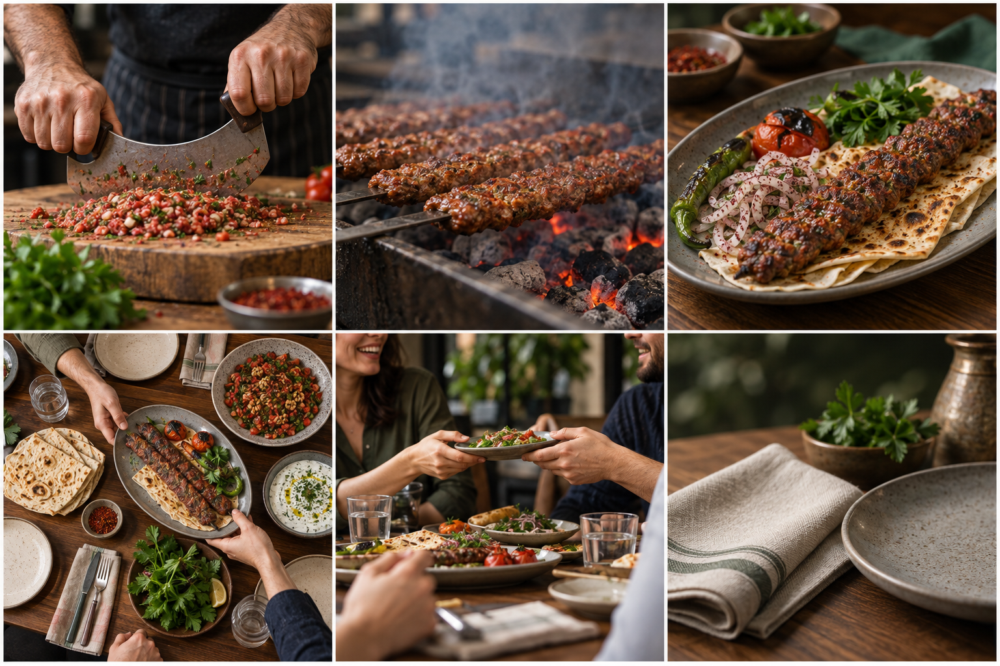

# Köşebaşı
## Tek çatı hikâye.
## Bütün markaya değer.

**Köşebaşı Merkez Yönetimine**

**Marka iletişimi önerisi · Franchise görüşme dayanakları · Moodboard**

intiba · 10 Eylül 2026

Merkez yönetimine önerimiz, Köşebaşı'nın ürününü, ustalığını ve sofra kültürünü tek bir çatı hikâyede birleştirmek; yüksek prodüksiyon kalitesiyle üretilen bu hikâyeyi Instagram'da yıl boyunca sürdürmektir.

Franchise işletmelerinden gelen görünürlük beklentisini, ortak marka tercihini güçlendirecek bir yatırımla karşılamayı öneriyoruz. Merkezde kurulacak içerik bankası bütün ağı temsil eder ve mevcut franchise hesaplarının da kullanabileceği profesyonel materyaller sağlar.

**Her şube için ayrı fotoğraf veya video çekimi yapılmayacak.** Çekim mekânları, ortak hikâyenin gerektirdiği sahnelere göre seçilecek. Filmlerin kahramanı Köşebaşı markası olacak.

> Üretim seçili mekânlarda gerçekleşir. Yatırımın hedefi, bütün ağın taşıdığı Köşebaşı adına duyulan ilgiyi güçlendirmektir.

Bu belge, merkez ekibinin yaratıcı yönü değerlendirmesi ve franchise sahiplerine yaklaşımın gerekçelerini somut örneklerle aktarabilmesi için hazırlanmıştır.

**Çalışma modeli:** Yılda dört çekim bloğu · blok başına en az 25 ortak içerik · 12 ay Instagram yönetimi.

<!-- pagebreak -->

# 01 · Merkez yönetimi için stratejik gerekçe

## Görünürlük talebini ortak marka yatırımına çevirmek

Franchise işletmelerinin beklentisi, kendi restoranlarının daha çok tercih edilmesidir. Merkezi iletişimin görevi, bu beklentiyi Köşebaşı'nı seçmek için güçlü bir neden etrafında birleştirmektir: hazırlanışına tanık olunan bir ürün, görülen bir ustalık ve katılmak istenen bir sofra.

Tek tek salonları ve cepheleri göstermek ilgili adresleri tanıtır. Çatı hikâye ise Köşebaşı'nın bütün adreslerinde taşınan marka adına anlam kazandırmayı hedefler. Böylece yaratıcı çalışma, ağın tamamının yararlanabileceği bir içeriğe dönüşür.

## Franchise katkısını anlatan örnek ziyaret yolu

Bir kişi Instagram'da Köşebaşı'nın filmini izler. Ustanın hazırlığını, yemeğin ocağa gelişini ve sofradaki paylaşımı görür. Yemek planı yaparken Köşebaşı'nı düşünür ve kendisine uygun şubeyi seçer. **Seçtiği şube filmde hiç görünmemiş olabilir; tercih etmek istediği marka o şubenin tabelasında vardır.**

Bu örnek, iletişimle oluşturmak istediğimiz yolu açıklar. Sonuç, içeriğin kimlere ulaştığına ve şubede karşılaşılan deneyime de bağlıdır.

## Merkezin kullanabileceği somut dayanaklar

| Dayanak | Ağ açısından anlamı | Temeli |
| --- | --- | --- |
| Yılda 12 çekim günü | Hikâyenin ihtiyaçlarına göre planlanan ortak üretim kapasitesi | Mevcut teklif: 4 blok × 3 gün |
| Yılda en az 100 ortak içerik | Yıl boyunca beslenen ve merkezden paylaşılabilen içerik bankası | Mevcut teklif: 4 blok × en az 25 içerik |
| 12 ay Instagram yönetimi | Üretilen işlerin planlı yayına ve düzenli değerlendirmeye dönüşmesi | Mevcut teklifin çalışma ritmi |
| Ortak marka materyalleri | Franchise hesaplarının da aynı profesyonel içerikleri kullanabilmesi | Önerilen merkezi paylaşım modeli |

100 içerik, tüm marka için yıllık asgari toplamdır. Bu sayı şube başına bir teslim taahhüdü değildir.

## Bütçeyi bu amaçla toplamak

Şube şube çekimde hazırlık, ulaşım ve kurulum lokasyonlar arasında tekrarlanır. Ortak üretimde bu emek; senaryo, ışık, yemek stilistliği, ses ve kurgu için birlikte çalışır. Merkeze önerdiğimiz verimlilik, aynı yaratıcı yatırımın ağ genelinde kullanılabilmesi ve yayınlar boyunca değerini sürdürmesidir.

<!-- pagebreak -->

# 02 · Franchise görüşmeleri için dayanaklar

## Merkez ekibinin kullanabileceği açıklamalar

Aşağıdaki tablo, franchise görüşmelerinde karşılaşılabilecek beklentilere yönelik bir iletişim desteğidir. Açıklamaların yanında, merkez ekibinin gösterebileceği somut materyal veya plan yer alır.

| Franchise beklentisi | Merkezin aktarabileceği açıklama | Gösterilecek dayanak |
| --- | --- | --- |
| Kendi şubesinin görünmesi | Ortak film, işletmenin de taşıdığı Köşebaşı adına ilgi oluşturmayı hedefler. Çekim yapılan adres hikâyenin sahnesidir. | Örnek ziyaret yolu ve bütün markayı temsil eden ana film senaryosu |
| Yatırımın karşılığını görmek | Üretim, ortak filmler ve fotoğraflar olarak ağın kullanımına açılır; merkez bunları düzenli yayına dönüştürür. | Yıllık en az 100 ortak içerik çerçevesi, paylaşım düzeni ve Instagram takvimi |
| Çekim lokasyonunun seçimi | Mekân seçimi senaryo, mutfak ve çekim koşullarına göre yapılır. Film merkezden Köşebaşı adına yayınlanır. | Çekim listesi, mekân seçim ölçütleri ve ortak marka kapanışı |
| Yayınların tekrara düşmesi | Çatı hikâye; ürün, ustalık ve sofra üzerine farklı bölümler üretir. Görsel dil, içerikler arasındaki marka bağını korur. | Üç içerik serisi, moodboard ve ilk blok için 25 içerik dağılımı |
| Ticari katkının görülmesi | İlgi ve ziyaret niyeti düzenli raporlanır. Rezervasyon ve satış bağlantısı kurulabilen veriler ayrıca değerlendirilir. | Aylık rapor başlıkları ve erişilebilir veriler için merkezde tanımlanacak takip düzeni |

## Merkezin toplantıda kullanabileceği anlatım

“Köşebaşı'nın ustalığını, ürününü ve sofrasını insanların aklında kalacak bir hikâyeye dönüştürmeyi öneriyoruz. Amacımız, yemek planı yapan kişinin Köşebaşı'nı düşünmesi. O kişi kendisine uygun şubeyi seçtiğinde, ortak marka iletişimi o işletme için de çalışabilir.

Çekim yerini senaryonun ihtiyacına göre belirleyeceğiz. Üretilen işler Köşebaşı adına yayınlanacak ve mevcut şube hesaplarının da kullanabileceği ortak bir bankada toplanacak. Böylece aynı prodüksiyondan bütün ağ yararlanabilecek.”

## Merkezin sunumunda yan yana gösterilecekler

Üretim modeli, moodboard, ana filmin akışı ve örnek yayın takvimi birlikte sunulur. Böylece franchise görüşmesi, çekim sırası üzerinden ilerlemek yerine marka yatırımının içeriğini ve kullanımını değerlendirmeye açılır.

Merkez, beklentiyi ölçülü kurar: ortak iletişim marka tercihine katkı sağlamayı hedefler; her şubeye eşit rezervasyon veya ciro artışı vaat edilmez.

<!-- pagebreak -->

# 03 · Marka konumundan yaratıcı yöne

## Köklü ustalık, bugünün sofrası

Köşebaşı'nın resmî anlatısı, 1995'te Levent'te başlayan geçmişini ve Adana–Tarsus mutfağıyla bağını öne çıkarıyor. [Köşebaşı / Hakkımızda](https://www.kosebasi.com/category/about-us/55.html)

Bu zeminden çıkardığımız yaratıcı yön; köklü mutfak usullerini günümüzün şehirli sofra anlarıyla birlikte göstermektir. Markanın kendi görsellerindeki ortak sofralar, seramik tabaklar, ahşap ve yeşil tonları görsel araştırmamıza yön verdi. [Köşebaşı / Levent](https://kosebasi.com/sube/levent)

## Çatı hikâye önerisi: Bir sofranın etrafında

Bir buluşma kararlaştırılırken mutfakta hazırlık başlar. Birileri masaya yaklaşırken tabaklar tamamlanır. Hikâye, ocağın başındaki emekten sofranın etrafındaki insanlara uzanır. Ustalık ve paylaşım, aynı filmin birbirini tamamlayan parçaları olur.

| Süre | Ana filmin akışı | Görsel ve işitsel karşılık |
| --- | --- | --- |
| 00–08 sn | Buluşmaya doğru | Hazırlanan masa, yaklaşan eller; mutfaktan gelen hazırlık sesi |
| 08–20 sn | Sofranın öncesindeki emek | Ustanın eli, malzeme ve hazırlık; gerçek mutfak sesleri |
| 20–30 sn | Ateşten çıkan lezzet | Pişme, doku, tabaklama ve servise uzanan hareket |
| 30–40 sn | Buluşma | Ortaya gelen tabaklar, paylaşım ve sofranın tamamlanması |
| 40–45 sn | Ortak marka imzası | “Bir sofranın etrafında. Köşebaşı.” |

Filmin sonunda Köşebaşı markası yer alır. Çekim yapılan adres, bütün markayı anlatan sahnelere ev sahipliği yapar.

## Aynı hikâyeyi sürdüren üç seri

**Sofradan önce:** Hazırlık ve ustalık üzerine kısa filmler.

**Ortaya gelenler:** Malzemeden tabağa uzanan ürün ve meze hikâyeleri.

**Sofranın etrafında:** Paylaşım, servis ve buluşma anları.

Çatı fikir ve örnek film akışı, merkez yönetiminin değerlendirmesine sunulan yaratıcı önerilerdir. Kaynak ve ustalık iddiaları, senaryo kesinleşmeden önce marka tarafından doğrulanır.

<!-- pagebreak -->

# 04 · Moodboard: Bir sofranın etrafında

## Ustalık · ateş · ürün · sofra · insan · doku

<!-- palette -->

**Üst sıra:** Ustanın eli ve usul · kontrollü ateş ve pişme · ürünün dokusu.

**Alt sıra:** Ortak sofra · doğal paylaşım anı · seramik, keten ve ahşap.

Bu görsel yön; ürünün ve emeğin görünür olduğu, özenli ve güncel bir gastronomi anlatısını hedefler. Renkler, mevcut kurumsal kimlikle birlikte uygulanacak fotoğraf ve ışık paleti önerisidir.

**Görsel notu:** Moodboard yapay zekâ ile oluşturulmuş konsept referanslarından oluşur. Gerçek Köşebaşı şubesi, çalışanı veya onaylı menü fotoğrafı olarak sunulmaz; gerçek prodüksiyonun estetiğini tarif eder.

<!-- pagebreak -->

# 05 · Moodboard'un çekimdeki karşılığı

## Görsel kararların marka ile ilişkisi

| Görsel karar | Köşebaşı için amacı | Çekimde uygulanışı |
| --- | --- | --- |
| Ustanın eli ve yakın plan usul | Mutfak birikimini somut hareketlerde göstermek | Gerçek hazırlık sürecini ve tekniği izleyen kadrajlar |
| Ateş, pişme ve ürün dokusu | Lezzete ilişkin beklentiyi görünür ayrıntılarla kurmak | Kontrollü arka ışık, doğal pişme görüntüsü ve ölçülü duman |
| Mat seramik, ahşap ve keten | Özenli, dokusu hissedilen bir sofra dünyası kurmak | Marka sunumuna uygun servis malzemeleri ve sade düzen |
| Yeşil, krem ve doğal ürün renkleri | Gastronomi odağını koruyan sakin bir bütünlük | Dengeli beyazlar, doğal ten ve yemek renkleri |
| Sofra etrafında insan hareketleri | Ürünü bir araya gelme nedenine bağlamak | Tabak uzatma, servis ve paylaşımı izleyen doğal anlar |
| Ortak kurgu ve ses dili | Farklı içerikleri aynı marka hikâyesinde birleştirmek | Hazırlık, ocak ve servis sesleriyle kurulan tutarlı ritim |

## Işık, kamera ve insan

Tabaklarda yumuşak yan ışık; ocakta doku ve pişmeyi öne çıkaran kontrollü ışık kullanılır. Ürün kadrajları, masa yüksekliğindeki insan anları ve tepeden sofra planları birbirini tamamlar.

İnsanlar çağdaş şehir hayatına ait doğal kıyafet ve hareketlerle hikâyeye katılır. Ürün ve sofrayla kurdukları ilişki, filmin insani tarafını taşır. Oyuncu/model gereksinimi, mevcut teklifin kapsam koşulları içinde ayrıca belirlenir.

## Gerçek üretime geçerken

Merkez ekibi, çekilecek ürünleri, reçeteleri ve sunumları onaylar. Moodboard'daki tabak ve mekânlar gerçek çekimde birebir kopyalanacak unsurlar olarak ele alınmaz; görsel yönü göstermek için kullanılır.

Ürün, kaynak ve usul üzerinden kanıtlanabilir bir anlatı kurulur. Şubelerin bütün hizmet deneyimlerinin aynı olduğu yönünde bir vaat üretilmez.

**Instagram uygulaması:** Dikey film, kısa video, fotoğraf ve hikâye setleri aynı renk, ses ve kadraj yaklaşımını taşır. Gerçek çekimde dikey ve kare kullanım ihtiyaçları birlikte planlanır.

<!-- pagebreak -->

# 06 · Tek üretimden ortak içerik bankasına

## Çekim, ortak hikâyenin ihtiyaçlarına göre kurulacak

Senaryo, mutfak koşulları ve görsel ihtiyaçlar doğrultusunda uygun çekim mekânları seçilir. Üç günlük blok, bütün Köşebaşı iletişiminde kullanılabilecek ürün, usul ve sofra sahnelerini üretmek için planlanır.

**Üretim birimi Köşebaşı markasıdır.** Şube sayısına bağlı ayrı çekim, şube filmi veya aylık şube içerik paketi tanımlanmamaktadır.

| Ana teslim | Adet | Çatı hikâyedeki işlevi |
| --- | --- | --- |
| Ana marka filmi | 1 | Ortak hikâyeyi kuran 45 saniyelik film |
| Kısa dikey video | 8 | Ustalık, ürün ve sofra üzerine bağımsız bölümler |
| Fotoğraf veya kaydırmalı gönderi | 8 | Ortak ürün, hazırlık ve sofra fotoğrafları |
| Hikâye seti | 8 | Aynı anlatıyı sürdüren, 2–3 karelik yayınlar |
| Toplam | 25 | Bütün marka için üç aylık içerik bankası |

Bu dağılım, mevcut teklifteki en az 25 içerik için öneridir. Dil ve en-boy oranı değişiklikleri ayrı ana içerik sayılmaz. Dikey 9:16, kare formatlar, TR + EN altyazı ve fotoğraf seçkisi mevcut teklifin teslim çerçevesindedir.

## Üç günlük üretimin odağı

**Birinci gün:** Ürün, hazırlık, ustalık ve ocak sahneleri; gerçek ses kayıtları.

**İkinci gün:** Ana filmin sofra, servis ve buluşma sahneleri.

**Üçüncü gün:** Kısa hikâyeler için tamamlayıcı sahneler, ürün ve sofra fotoğrafları, eksik planlar.

## Merkezden franchise ağına paylaşım

Onaylı materyaller merkez tarafından ortak bir klasör ve yayın takvimiyle paylaşılır. Her dosyada kullanım formatı ve önerilen yayın metni bulunur. Mevcut franchise Instagram hesapları aynı marka materyallerinden yararlanabilir.

Merkez, hesap sahipleriyle paylaşım düzenini koordine eder. Bu kullanım modeli, franchise hesaplarının ajans tarafından ayrı ayrı yönetileceği anlamına gelmez.

<!-- pagebreak -->

# 07 · Instagram'da yıllık uygulama

## Tek hikâye, düzenli yayın

**ÇATI HİKÂYE → ORTAK İÇERİKLER → MARKA TERCİHİ**

Ana film Köşebaşı'nın dünyasını kurar. Kısa filmler, fotoğraflar ve hikâye setleri bu dünyayı ayrıntılandırır. Ana marka Instagram hesabındaki yayınlar, aynı görsel hafızayı güçlendirecek biçimde planlanır.

Mevcut franchise hesaplarında aynı materyallerin paylaşılması, ortak anlatının dağıtımını genişletebilir. Ziyaret planlayan kişi, markanın mevcut şube ve rezervasyon kanallarından devam eder.

| Dönem | Yapılacak iş | Çıktı |
| --- | --- | --- |
| 1–2. hafta | Merkez görüşmesi, çatı hikâye, moodboard ve senaryo | Onaylı yaratıcı yön ve çekim planı |
| 3–4. hafta | Üç günlük çekim, ilk kurgular ve yayın hazırlığı | Ana film, ilk içerikler ve yayın takvimi |
| 2. ay | Ürün, ustalık ve sofra bölümlerinin yayını | Düzenli iletişim ve ilk performans değerlendirmesi |
| 3. ay | İçerik bankasının yayını, etkili anlatıların değerlendirilmesi | İlk çeyrek raporu ve sonraki çekim bloğunun planı |

Sonraki bloklar 4., 7. ve 10. aylarda aynı çatı hikâyeyi yeni ürünler ve mevsimsel sahnelerle besler. Yıllık değerlendirme 12. ayda yapılır.

## Merkez ve ajansın sorumlulukları

**intiba:** Yaratıcı yön, üretim, kurgu, ana Instagram hesabının yayın planı ve raporlama.

**Köşebaşı merkez:** Ürün doğruluğu, tekleştirilmiş marka onayı, çekim koordinasyonu ve ortak materyallerin franchise ağıyla paylaşım düzeni.

Yorum ve mesaj yanıtları mevcut teklifte olduğu gibi marka ekibinde kalır.

## Merkezin franchise görüşmelerine taşıyabileceği sonuçlar

Rapor; gerçekleşen yayınları, erişimi, izlenme süresini, benzer uzunluktaki videolarda tamamlanmayı, paylaşım ve kaydetmeyi içerir. Erişilebilir verilerle menü, şube listesi ve rezervasyon kanallarına yönelme de değerlendirilir.

Rezervasyon ve satış sonuçları, iletişimle kaynak bağlantısı kurulabildiği ölçüde ayrıca ele alınır. Erişim veya tıklama, gerçekleşmiş ziyaret olarak raporlanmaz.

<!-- pagebreak -->

# 08 · Yatırım çerçevesi ve başlangıç

## Mevcut teklifin uygulama modeli

Eylül 2026 tarihli teklif; dört adet üç günlük çekim bloğu ve 12 aylık kesintisiz kanal yönetimi üzerinden kuruludur. Yayın ve kanal yönetimi kapsamı Instagram'dır.

| Kalem | Birim bedel | Yıllık karşılık |
| --- | --- | --- |
| Kanal yönetimi | 100.000 TL / ay | 1.200.000 TL |
| Çekim blokları | 250.000 TL / üç günlük blok | 1.000.000 TL / dört blok |
| Yıllık toplam | KDV hariç | 2.200.000 TL |

Marka çalışması, içerik stratejisi, ekip ve ekipman, İstanbul içi ulaşım, yemek stilistliği, kurgu ve son işlem, içerik bankası ve raporlama önceki teklifte yer alır. Bu kapasite, ortak çatı hikâyenin üretimi ve Instagram yayını için kullanılır.

Oyuncu/model, özel müzik lisansı, reklam ve medya harcaması, şehir dışı/yurt dışı çekim ve çekimde tüketilen ürün önceki teklifin kapsam dışı kalemleridir. Ana filmin gereksinimleri bu çerçevede kesinleştirilir.

## Merkez yönetimiyle netleştirilecek kararlar

**Yaratıcı yön:** Çatı hikâye, moodboard ve öncelikli ürün/usul anlatıları.

**Üretim:** Hikâyenin gerektirdiği mekânlar, çekim hazırlığı ve ilk blok tarihi.

**Ağ iletişimi:** Franchise görüşmelerinde kullanılacak anlatım, ortak materyallerin paylaşım düzeni ve merkez sorumlusu.

**Yayın:** İlk üç aylık Instagram takvimi, onay akışı ve erişilebilir ölçüm verileri.

> Önerimiz, Köşebaşı'nın ortak marka gücüne yatırım yapmak ve merkezin bu yatırımın değerini franchise ağına somut işler, açık bir kullanım modeli ve düzenli raporlarla gösterebilmesidir.

Kaynak: intiba, “Köşebaşı — İçerik ve Sosyal Medya Teklifi”, Eylül 2026, III–VI ve IX. bölümler. Adet ve bedeller mevcut tekliften alınmıştır. Yıllık 100 içerik alt sınırı, dört blok × en az 25 içerik hesabıdır.

Kaynak: Marka bağlamı ve görsel araştırma için Köşebaşı'nın resmî Hakkımızda ve Levent sayfaları 10 Eylül 2026 tarihinde incelenmiştir. Çatı hikâye, franchise açıklamaları ve moodboard, intiba tarafından bu çalışma için geliştirilen önerilerdir.

**intiba** · Köşebaşı Merkez Yönetimi için hazırlanmıştır · 10 Eylül 2026
